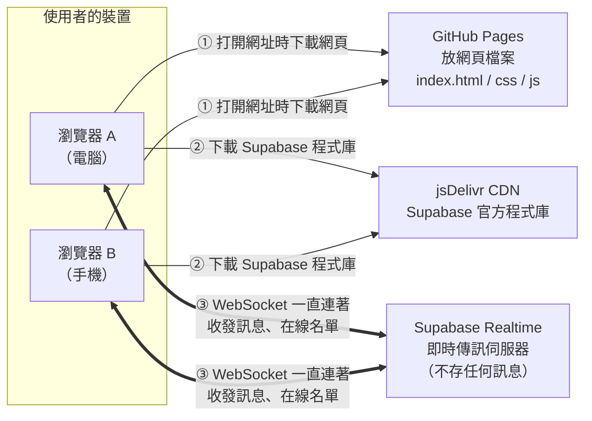
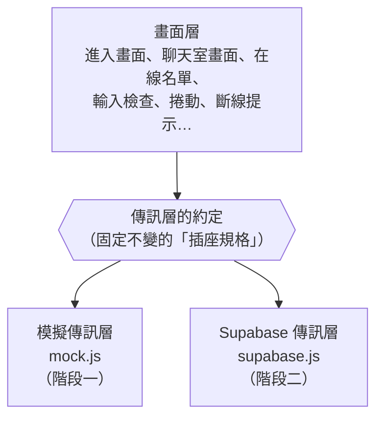
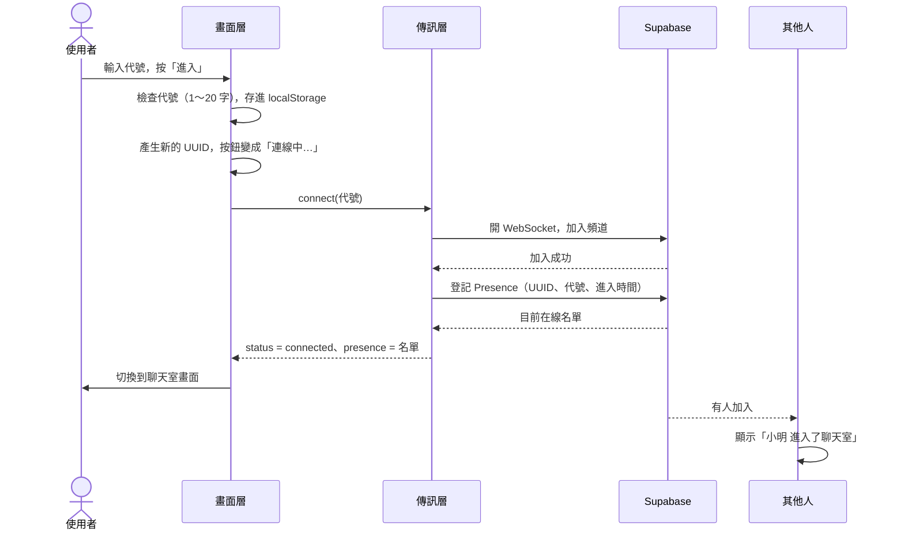

# 架構文件：匿名聊天室

> 這份文件根據 `docs/requirements.md` 以及和需求方逐題確認過的共識寫成。
> 專有名詞第一次出現時，會用一句話解釋。

---

## 1. 專案說明與目標

### 這是什麼
一個**不用註冊、不用登入**的網頁聊天室。全世界只有一間聊天室，任何拿到網址的人都能進來，輸入一個代號就能開始聊天。電腦和手機都要好用。

### 目標
1. 打開網址 → 輸入代號 → 進入聊天室，三步以內就能開始聊。
2. 看得到誰在線上，有人進出時會有提示。
3. 每則訊息都顯示代號和時間。
4. 手機上好用，整個頁面不會左右捲動。
5. 不保留任何聊天紀錄，聊完就散。
6. 盡量用免費服務，不需要自己管理伺服器。

### 分兩個階段完成
- **階段一**：只做網頁（前端），先放上網，用「模擬模式」就能完整試用。
- **階段二**：接上 Supabase，變成真的可以跟別人即時聊天。

---

## 2. 整體架構圖

先解釋幾個名詞：
- **前端**：在使用者瀏覽器裡執行的部分，也就是看得到、摸得到的網頁。
- **GitHub Pages**：GitHub 提供的免費網頁空間，會把 repo 裡的檔案變成一個網址讓人瀏覽。
- **repo（儲存庫）**：放在 GitHub 上的專案資料夾，裡面的每個檔案都有修改紀錄。
- **Supabase**：一個雲端服務。這個專案只用它的「即時傳訊」功能，負責把一個人送出的訊息馬上轉給其他所有人。
- **WebSocket**：瀏覽器和伺服器之間一條一直保持連著的通道，雙方都可以隨時傳東西給對方，所以訊息可以「即時」送到。
- **CDN**：把常用程式檔放在全球各地的伺服器上，讓瀏覽器就近下載。這裡用 jsDelivr 這個 CDN 下載 Supabase 官方提供的程式。



**重點**
- GitHub Pages 只負責「把網頁交給瀏覽器」，交完就沒它的事了。它不經手任何聊天訊息。
- 聊天訊息只會經過 Supabase 轉送，**不會被存起來**。
- 瀏覽器 A 和 B 不會直接相連，都是透過 Supabase 轉送。
- 階段一還沒有 Supabase，第 ③ 步改由瀏覽器裡的「模擬器」假裝有其他人（見第 4 節）。

---

## 3. 技術選擇

### 3.1 前端語言：HTML + CSS + JavaScript
- **選了什麼**：網頁最基本的三種語言。**HTML** 決定畫面上有哪些東西（按鈕、輸入框）；**CSS** 決定這些東西長什麼樣子、怎麼排；**JavaScript** 決定按下按鈕之後會發生什麼事。
- **為什麼**：所有瀏覽器都看得懂這三種語言，不用額外工具轉換。檔案寫好推上 GitHub 就能直接上線。

### 3.2 框架：不用框架
- **選了什麼**：不用 React、Vue 這類**框架**（別人先寫好的一大套程式骨架，適合做大型網頁），也不用**編譯工具**（把程式先轉換、打包過才能上線的工具）。
- **為什麼**：
  - 這個聊天室只有兩個畫面（進入畫面、聊天室畫面），用框架帶來的麻煩比好處多。
  - 不用編譯的話，GitHub 上的檔案就是網站實際在跑的檔案，出問題時最容易追查。
  - 不用安裝 Node.js 之類的開發工具，部署也不用設定自動化流程。
- **代價**：如果以後功能變得很多（例如多個聊天室、私訊），可能要改用框架。目前的需求用不到。

### 3.3 JavaScript 的組織方式：ES Modules
- **選了什麼**：把程式拆成幾個小檔案，每個檔案負責一件事，彼此用 `import` 引用。這是瀏覽器內建的功能，叫 **ES Modules**。
- **為什麼**：不用編譯工具也能把程式分門別類。最重要的是可以把「傳訊方式」獨立成一個檔案，從階段一換到階段二時只要換掉那個檔案（見第 4 節）。

### 3.4 即時傳訊：Supabase Realtime 的 Broadcast 和 Presence
Supabase 有很多功能（資料庫、登入、檔案儲存…），這個專案**只用 Realtime（即時功能）裡的兩項**：

| 功能 | 一句話解釋 | 用來做什麼 |
|---|---|---|
| **Channel（頻道）** | 一個「房間」，加入同一個頻道的人才收得到彼此的東西 | 整個聊天室就是一個頻道 |
| **Broadcast（廣播）** | 送一則訊息給頻道裡的所有人，Supabase 轉送完就丟掉，不會存起來 | 聊天訊息 |
| **Presence（在線狀態）** | Supabase 幫忙記住「現在誰在頻道裡」，有人進來或離開時通知所有人 | 在線名單、進出提示 |

- **為什麼選 Broadcast，而不是把訊息存進資料庫**：共識是「不保留歷史」，Broadcast 本來就不存訊息，剛好符合需求。不用建資料表，也不用設定資料表權限，設定最少、風險最低。
- **為什麼選 Presence**：「誰在線上」和「有人進出的提示」正是它的用途。連關掉分頁、手機斷線的情況，Supabase 都會自己偵測到，然後通知其他人（會晚幾秒到幾十秒）。
- **不用的功能**：Database（資料庫）、Auth（登入）、Storage（檔案）、Edge Functions（雲端程式）。

### 3.5 Supabase 程式庫：從 CDN 載入，鎖定固定版本
- **選了什麼**：用 Supabase 官方的 JavaScript 程式庫 `@supabase/supabase-js`，從 jsDelivr CDN 載入，網址裡寫死一個確切的版本號（目前是 `@supabase/supabase-js@2.117.2`）。
- **為什麼**：不用安裝任何東西。版本寫死的話，官方出新版也不會突然把我們的網站弄壞。

### 3.6 其他小選擇
| 項目 | 選了什麼 | 為什麼 |
|---|---|---|
| 記住上次的代號 | 瀏覽器的 **localStorage**（瀏覽器裡的小儲物櫃，只有這台裝置的這個瀏覽器讀得到） | 不用伺服器也能記住；別台裝置看不到 |
| 每個人的身分 | 每次按「進入」時隨機產生一組 **UUID**（一串幾乎不可能重複的亂碼，例如 `3f2a…`） | 代號可以重複，所以要用另一個東西分辨「這是誰」 |
| 時間 | 用**收到訊息那台裝置自己的時鐘**，顯示成 24 小時制的「14:05」 | 不同人的電腦時鐘可能不準，也有人可能故意寫假時間；用自己收到的時間最可靠 |
| 階段一的跨分頁模擬 | 瀏覽器內建的 **BroadcastChannel**（同一個瀏覽器的不同分頁之間互相傳話的功能，跟 Supabase 的 Broadcast 是不同東西） | 階段一就能開兩個分頁真的互聊，測試起來更像真的 |

---

## 4. 兩個階段

### 4.0 關鍵設計：把「傳訊層」獨立出來

前端程式分成兩層：



可以把它想成**插座和插頭**：
- **畫面層**只認得一種「插座規格」：它只會說「幫我連線」「幫我送這則訊息」「我要離開了」，也只聽得懂「有新訊息」「名單變了」「有人進來」「有人離開」「連線狀態變了」這幾種通知。
- **傳訊層**是插頭。階段一插的是「模擬器」，階段二換成「Supabase」。兩個插頭的形狀完全一樣，所以畫面層一行都不用改。
- 要用哪一個插頭，由設定檔 `js/config.js` 決定。

**傳訊層必須提供的功能（插座規格）**

| 畫面層叫傳訊層做的事 | 意思 |
|---|---|
| `connect({ userId, nickname, joinedAt })` | 用這個身分（UUID、代號、進入時間）加入聊天室 |
| `send(文字)` | 送出一則訊息，回報成功或失敗 |
| `leave()` | 離開聊天室，切斷連線 |

| 傳訊層通知畫面層的事 | 意思 |
|---|---|
| `status` | 連線狀態變了：`connecting`（連線中）、`connected`（已連上）、`reconnecting`（斷線，正在重連）、`failed`（第一次就連不上） |
| `presence` | 目前在線的完整名單 |
| `join` | 有人進來了（可能包含自己，畫面層會濾掉） |
| `leave` | 有人離開了（可能包含自己，畫面層會濾掉） |
| `message` | 收到別人的一則訊息 |

**哪些事一定要放在畫面層，不能放在傳訊層**：輸入檢查、洗版限制、收到的訊息要不要接受（見第 9 節）、捲動、斷線提示。這樣兩個階段的行為才會一模一樣，階段一測過的東西，到了階段二不用重測一次邏輯。

### 4.1 階段一：只有前端，用模擬模式

**要做到的程度**：除了「真的跟別台裝置的人聊天」以外，**所有畫面和行為都要做好**。共識裡的每一條都要能在階段一試出來。

**模擬模式會做的事**
1. **模擬的其他使用者**：會有幾個假的人（例如「路人甲」「小貓」「夜貓子」）不定時進來、說幾句話、離開，讓在線名單、進出提示、新訊息提示都會動。
2. **同一個瀏覽器開兩個分頁可以真的互聊**：用 BroadcastChannel 讓兩個分頁看到彼此的訊息、出現在彼此的名單上。方便測試「自己的訊息靠右、別人的靠左」。
3. **可以模擬斷線**：在網址後面加參數就能觸發（參數是網址 `?` 後面的文字，用來傳設定給網頁）：
   - `?test=disconnect`：進入 15 秒後假裝斷線，再過 10 秒自動連回來。
   - `?test=fail`：第一次連線就失敗，用來看「無法連線」和「重試」按鈕。
   - `?bots=0`：關掉假的使用者，給自動測試用，畫面不會被隨機訊息干擾。
4. **畫面上有一條「展示模式」標示**，寫著「目前是展示模式，其他人都是模擬的」，避免有人拿到網址以為真的在跟人聊天。這條標示只在模擬模式出現。

**怎麼在 GitHub Pages 上看到效果**
1. 把檔案推上 GitHub（**push**：把電腦上的修改上傳到 GitHub）。
2. 照第 12 節開好 GitHub Pages。
3. 用電腦和手機打開 `https://<你的帳號>.github.io/anonymous-chat/`，就可以完整試用。

**階段一的做事順序**
1. 用 `/design` 設計兩個畫面的外觀（第 7 節列出要有哪些元素）。
2. 用 `/frontend-design` 照著設計，做出 HTML、CSS 和畫面層的程式。
3. 寫模擬傳訊層 `mock.js`。
4. 上線到 GitHub Pages，照第 13 節的階段一清單驗證。

### 4.2 階段二：接上 Supabase

**會改變的**
1. 新增 `js/transport/supabase.js`（Supabase 傳訊層），照「插座規格」把 Broadcast 和 Presence 包起來。
2. 在 `js/config.js` 裡填入 Supabase 的網址和公開金鑰，把模式從 `mock` 改成 `supabase`。
3. 「展示模式」標示自動消失。
4. 在 Supabase 網站上建立專案（見第 8 節）。

**不會改變的**
- 所有畫面、檢查規則、捲動、斷線提示的程式都不會改變。
- `mock.js` 會留著。之後只要在網址加上 `?mock=1`，就能隨時切回模擬模式測試或展示，不會用掉 Supabase 的免費額度。

---

## 5. 通訊約定

這一節規定瀏覽器之間透過 Supabase 傳遞的東西長什麼樣子。資料格式用 **JSON**：一種用 `{ "名稱": 值 }` 來寫資料的文字格式，幾乎所有程式語言都看得懂。

### 5.1 頻道
| 項目 | 值 |
|---|---|
| 頻道名稱 | `anonymous-chat:lobby` |
| 頻道類型 | 公開頻道（不用登入就能加入） |
| Broadcast 設定 | `self: false`（自己送的訊息不會再傳回給自己），`ack: true`（Supabase 收到後會回一聲「收到了」，用來判斷有沒有送出成功） |
| Presence 的 key | 使用者的 UUID（每個人在名單上的編號） |

### 5.2 事件一：聊天訊息（Broadcast，事件名稱 `chat-message`）

```json
{
  "v": 1,
  "id": "b1e4c2a0-8f3d-4e8a-9c71-2d5f6a7b8c90",
  "userId": "3f2a9d1e-77c4-4b0a-a1f2-0c9e8d7b6a54",
  "nickname": "小明",
  "text": "大家好\n第二行"
}
```

| 欄位 | 意思 | 規則 |
|---|---|---|
| `v` | 格式版本 | 目前固定是 `1`。收到不認得的版本就丟掉 |
| `id` | 這則訊息的編號（UUID） | 用來避免同一則訊息重複顯示 |
| `userId` | 送出者的 UUID | 每次按「進入」時隨機產生 |
| `nickname` | 送出者的代號 | 1～20 字，前後沒有空白 |
| `text` | 訊息內容 | 1～500 字，可以有換行，不能全是空白 |

- **時間不放在訊息裡**，由收到的那台裝置記下自己收到的時間（見 3.6）。
- 「字數」的算法：一個中文字、一個英文字母、一個表情符號都算 1 個字。

### 5.3 事件二：在線狀態（Presence）

每個人加入頻道後，向 Supabase 登記自己的資料：

```json
{
  "userId": "3f2a9d1e-77c4-4b0a-a1f2-0c9e8d7b6a54",
  "nickname": "小明",
  "joinedAt": 1760943900000
}
```

| 欄位 | 意思 |
|---|---|
| `userId` | 這個人的 UUID |
| `nickname` | 代號 |
| `joinedAt` | 進入的時間（從 1970 年起算的毫秒數，程式常用的時間寫法），只用來排列在線名單的順序 |

Supabase 會發出三種 Presence 通知，前端這樣使用：
| Supabase 的通知 | 前端要做的事 |
|---|---|
| `sync`（名單同步） | 重畫在線名單 |
| `join`（有人加入） | 不是自己的話，顯示「XXX 進入了聊天室」 |
| `leave`（有人離開） | 不是自己的話，顯示「XXX 離開了」 |

剛進入時，Supabase 會把「原本就在線上的人」一次告訴你。這些人**不顯示進入提示**，只放進名單。

---

## 6. 資料流

### 6.1 進入聊天室



- 10 秒內連不上的話：留在進入畫面，顯示「無法連線，請稍後再試」和「重試」按鈕。
- 名單已滿（超過免費方案的同時連線上限）時也會連不上，看到的是同一個提示。

### 6.2 送出訊息
1. 使用者按「送出」或 Enter。
2. 畫面層檢查：不是空白、不超過 500 字、沒有洗版（5 秒內不超過 5 則）、目前是連線中。沒通過就不送，並顯示原因。
3. 畫面層**馬上**把訊息顯示在自己畫面的右邊，時間用現在的時間，清空輸入框，捲到最底下。
4. 傳訊層透過 Broadcast 送出。
5. Supabase 回「收到了」→ 完成。如果沒收到回覆或送出失敗 → 那則訊息旁邊標示「未送出」。
6. Supabase 把訊息轉給其他人 → 其他人的畫面層檢查內容（第 9 節）→ 顯示在左邊，時間用他們收到的時間。

### 6.3 離開
1. 使用者按「離開」，**不跳確認視窗**。
2. 傳訊層取消 Presence 登記、離開頻道、關掉連線。
3. 畫面清空所有訊息，回到進入畫面，代號欄填好剛剛的代號。
4. 其他人收到 `leave` 通知 → 顯示「小明 離開了」。

**關掉分頁或手機斷線**：前端來不及通知。Supabase 發現這條連線好一陣子沒有回應，就會自己判定這個人離開了，再通知其他人。所以提示會晚幾秒到幾十秒出現。

### 6.4 斷線與重連
1. **發現斷線**：Supabase 程式庫回報頻道出錯或逾時，或瀏覽器回報「網路斷了」（瀏覽器本身會通知網頁目前有沒有網路）。
2. 畫面層顯示黃色提示「連線中斷，正在重新連線…」。輸入框還能打字，「送出」按鈕不能按。
3. Supabase 程式庫會自己一直重試連線。手機從背景切回來時，畫面層也會主動檢查一次連線。
4. **連回來後**：重新加入頻道，用**同一個 UUID** 重新登記 Presence，然後重新整理名單，提示消失，「送出」按鈕恢復。
5. 斷線期間別人說的話會漏掉，不會補回來（因為不保留歷史）。
6. 其他人那邊可能會看到「小明 離開了」接著「小明 進入了聊天室」，這是正常的。

---

## 7. 畫面清單

只寫「有什麼」和「會做什麼」。顏色、字型、圓角、間距等外觀交給 `/design` 決定。

### 7.1 進入畫面

| 元素 | 行為 |
|---|---|
| 聊天室名稱 | 固定文字 |
| 代號輸入框 | 自動填上次的代號。最多 20 字。在輸入框按 Enter 等於按「進入」 |
| 「進入」按鈕 | 代號去掉前後空白後是空的，就不能按。按下後變成「連線中…」，不能重複按 |
| 錯誤提示 | 連不上時顯示「無法連線，請稍後再試」 |
| 「重試」按鈕 | 只在連不上時出現，按下後重新連線 |
| 「展示模式」標示 | 只在模擬模式出現 |

### 7.2 聊天室畫面

**頂端列**
| 元素 | 行為 |
|---|---|
| 聊天室名稱 | 固定文字 |
| 自己的代號 | 顯示目前使用的代號 |
| 「離開」按鈕 | 按下直接離開，回到進入畫面，不跳確認視窗 |

**斷線提示條**
| 元素 | 行為 |
|---|---|
| 「連線中斷，正在重新連線…」 | 只在斷線時出現在頂端，連回來後自動消失 |

**在線名單**
| 元素 | 行為 |
|---|---|
| 人數 | 例如「線上 5 人」 |
| 代號清單 | 依進入順序排列。自己的代號後面加「（你）」。代號重複時就照樣顯示兩個 |
| 寬螢幕（大約 768 像素以上，例如電腦） | 放在聊天區旁邊，一直顯示 |
| 窄螢幕（例如手機） | 固定在訊息區上方，最多兩行高。人多時名單區塊自己上下捲動，整個頁面不能左右捲動 |

**訊息區**
| 元素 | 行為 |
|---|---|
| 空白提示 | 還沒有任何訊息時，顯示「還沒有人說話，打個招呼吧」 |
| 別人的訊息 | 靠左，顯示代號、時間（14:05）、內容 |
| 自己的訊息 | 靠右，跟別人的訊息用不同顏色，顯示代號、時間、內容。送出失敗時標示「未送出」 |
| 進出提示 | 夾在訊息中間、置中的一行小字：「小明 進入了聊天室」「小明 離開了」 |
| 訊息內容 | 只顯示純文字，保留換行。網址不會變成可以點的連結。很長、沒有空格的字串會自動折行 |
| 自動捲動 | 在最底下時，新訊息進來會自動往下捲。往上看舊訊息時，畫面不會自己跳走 |
| 「↓ 有 N 則新訊息」 | 往上看舊訊息時有新訊息進來才出現，點一下就捲到最底下並消失 |
| 訊息數量上限 | 畫面上最多保留最近 500 則，更舊的自動移除，避免手機越用越卡 |

**輸入區**
| 元素 | 行為 |
|---|---|
| 訊息輸入框 | 可以多行，會隨著內容長高到一定高度。電腦：Enter 送出、Shift+Enter 換行。手機：換行鍵就是換行 |
| 字數提示 | 超過 500 字時顯示「512 / 500」之類的字數 |
| 「送出」按鈕 | 電腦和手機都有。空白、超過 500 字、斷線時不能按 |
| 洗版提示 | 5 秒內超過 5 則時顯示「送太快了，稍等一下」，幾秒後消失 |
| 送出之後 | 輸入框清空，游標留在輸入框裡，捲到最底下 |

**整體**
- 深色或淺色跟著裝置的系統設定，不提供切換按鈕。
- 不管什麼寬度都不能左右捲動。
- 只用鍵盤也能操作所有按鈕。

---

## 8. 金鑰

**金鑰**：一串很長的文字，像通行證，Supabase 靠它認出「是哪個專案的網站在跟我說話」、「這個人有哪些權限」。

### 8.1 這個專案會碰到的東西

| 名稱 | 是什麼 | 可以公開嗎 | 放在哪裡 |
|---|---|---|---|
| **Project URL** | Supabase 專案的網址，例如 `https://abcd1234.supabase.co` | ✅ 可以 | `js/config.js`，會上傳到 GitHub |
| **Publishable key**（舊專案叫 **anon key**） | 給網頁用的公開金鑰，權限很低 | ✅ 可以 | `js/config.js`，會上傳到 GitHub |
| **Secret key**（舊專案叫 **service_role key**） | 管理員金鑰，可以略過所有權限限制 | ❌ **絕對不能** | **哪裡都不放**。這個專案用不到，連複製都不要複製 |
| **資料庫密碼** | 建立專案時設定的密碼 | ❌ **絕對不能** | 只存在你的密碼管理工具裡。這個專案用不到 |
| **Supabase 帳號密碼** | 登入 Supabase 網站用的 | ❌ **絕對不能** | 只有你自己知道 |

### 8.2 為什麼 Publishable key 可以公開
網頁的程式碼會被下載到每個訪客的瀏覽器裡，誰都可以按 F12 打開來看。所以**放在網頁裡的東西本來就藏不住**。Supabase 是照這個前提設計的：Publishable key 本來就是要放在網頁裡給所有人看的。它能做的事，跟任何一個訪客本來就能做的一樣（加入公開頻道、收發訊息）。

我們沒有建任何資料表，所以拿到這把金鑰的人也讀不到、改不了任何資料。

**要接受的風險**：有人可以拿這把金鑰寫程式，直接連到我們的頻道送訊息，或用掉我們的免費額度。前端的防護見第 9 節。真的被濫用時，到 Supabase 後台產生新的 Publishable key、停用舊的，再更新 `js/config.js` 就可以了。

### 8.3 怎麼產生（階段二才做）
1. 到 Supabase 官網註冊帳號。
2. 建立新專案（**New project**）：
   - 名稱：`anonymous-chat`
   - 地區（Region）：選離台灣近的，例如 Tokyo（東京）或 Singapore（新加坡）
   - 資料庫密碼：按「產生」，存進密碼管理工具。之後用不到，但不能外流
   - 方案：Free（免費）
3. 專案建好後，到 **Project Settings → API Keys**（後台介面可能改版，找名稱相近的地方），複製 **Project URL** 和 **Publishable key**。
4. 到 Realtime 的設定頁，確認公開頻道是允許的（如果有「Allow public access」之類的選項，要保持開啟）。
5. **不用**建資料表、**不用**開登入功能、**不用**碰 Secret key。

### 8.4 怎麼避免把祕密 commit 到 GitHub
**commit**：把一批修改存成一個版本記錄。存進去之後，就算之後刪掉檔案，舊版本裡還是看得到。所以重點是「一開始就不要放進去」。

1. **最根本的方法：用不到的就不拿**。這個專案從頭到尾只需要 Project URL 和 Publishable key，兩個都可以公開。Secret key 和資料庫密碼不要複製到電腦上的任何檔案裡。
2. **`.gitignore`**（告訴 Git「這些檔案不要記錄」的清單）裡加上 `.env`、`.env.*`、`*.local`、`secrets/`。萬一以後真的有私密設定，放在這些名稱的檔案裡就不會被上傳。
3. **開啟 GitHub 的 Secret scanning 和 Push protection**（repo 的 Settings → Code security）：GitHub 會自動檢查上傳的內容，發現常見的祕密金鑰就擋下或警告。這是第二層保護，不能只靠它。
4. **萬一真的不小心上傳了 Secret key**：馬上到 Supabase 後台把那把金鑰停用、換一把新的。光刪掉檔案沒有用，因為舊版本裡還看得到。

---

## 9. 安全與限制

### 9.1 別人可能送進來的奇怪東西，以及前端怎麼擋

因為頻道是公開的，有人可以不透過我們的網頁，自己寫程式送任何東西進來。**我們自己網頁裡的檢查擋不住他送出**，所以每個人的網頁在**收到**訊息時都要自己檢查。不合格就直接丟掉，不顯示。

| 可能的狀況 | 前端怎麼處理 |
|---|---|
| 塞程式碼進訊息，想讓它在別人的瀏覽器裡執行（這種攻擊叫 **XSS**，跨網站指令碼攻擊） | 所有訊息和代號都**當成純文字顯示**，永遠不會當成網頁程式碼解讀。這是最重要的一條 |
| 格式不對：少欄位、型別錯誤、版本不認得 | 丟掉 |
| 代號超過 20 字、是空白，或訊息超過 500 字、是空白 | 丟掉 |
| 冒充我自己的 UUID，想讓訊息出現在我畫面的右邊 | 我自己送的訊息不會傳回給我（`self: false`），所以收到的訊息如果寫的是我的 UUID，一定是假的，丟掉 |
| 冒用別人的代號 | 擋不了，因為本來就沒有登入、代號也可以重複。這是匿名聊天室本來就有的限制 |
| 同一則訊息重送很多次 | 用訊息 `id` 判斷，看過的就不再顯示 |
| 用程式狂送訊息洗版 | 收到同一個 UUID 在 5 秒內超過 10 則，多的就丟掉（自己送出的限制是 5 則，這裡放寬一點，避免誤擋正常的人） |
| 一則訊息塞滿換行，把畫面撐得很長 | 連續超過 2 個空行時，只保留 2 個 |
| 隱形字元、讓文字反著顯示的特殊字元（可以用來假造畫面） | 顯示前先移除這類控制字元 |
| 很長、沒有空格的字串 | 自動折行，不會讓頁面可以左右捲動 |
| 貼釣魚網址 | 網址不會變成可以點的連結，使用者要自己複製才打得開 |
| 在 Presence 裡登記奇怪的資料 | 用同樣的規則檢查，不合格的就不放進名單 |

**擋不了的事（老實說）**：髒話、騷擾、廣告、冒用代號，或用大量假連線把名單塞滿。這一版不做過濾和檢舉（見第 10 節）。真的有人濫用時，最快的處理方法是更換 Publishable key。

### 9.2 免費方案的上限

以下數字是撰寫時的大概值，**實際以官方網站為準**，之後可能會變。

**Supabase 免費方案**
| 項目 | 大約上限 | 對我們的影響 |
|---|---|---|
| 同時連線數 | 約 200 個 | 同時大約 200 人在線就滿了，第 201 人會看到「無法連線」 |
| 每月訊息數 | 約 200 萬則 | Supabase 是「送出一次 + 每個收到的人各一次」分開計算。例如 50 人在線時送 1 則，大約算 51 則 |
| 每秒訊息數 | 約 100 則 | 人多又聊得快時可能會被限速 |
| 單則訊息大小 | 約 256 KB | 我們的訊息最多 500 字，遠低於上限 |
| 閒置暫停 | 一段時間（約一週）沒人用，專案可能會被自動暫停 | 暫停後網頁會一直顯示「無法連線」。要到 Supabase 後台按恢復（Restore） |

**GitHub Pages**
| 項目 | 限制 |
|---|---|
| repo 必須公開 | 免費帳號只能用公開的 repo 開 GitHub Pages，所以所有程式碼和文件都會公開（第 8 節說明了為什麼這樣沒問題） |
| 網站大小 | 約 1 GB，我們只會用到不到 1 MB |
| 每月流量 | 約 100 GB，我們不太可能用到 |
| 更新速度 | push 之後大約 1～2 分鐘才會更新 |

---

## 10. 這一版刻意不做的事

| 不做的事 | 為什麼 |
|---|---|
| 歷史訊息 | 共識：聊完就散。不存訊息就不用資料庫，也不會留下任何人說過的話 |
| 註冊、登入 | 需求明確說不要 |
| 代號不能重複 | 沒有伺服器幫忙，做不到完全可靠，還會讓使用者卡在第一步 |
| 多個聊天室、私訊 | 需求只要一間聊天室 |
| 傳圖片、檔案、貼圖 | 要用到儲存空間，也要處理不當內容，複雜度高很多 |
| 編輯、刪除、回覆特定訊息、按讚 | 需求沒有提到；不存歷史的話，這些功能的意義也不大 |
| 髒話過濾、檢舉、封鎖 | 共識：不做。沒有伺服器的話，過濾也很容易被繞過 |
| 在伺服器端擋洗版 | 需要另外寫雲端程式。這一版只在前端擋（送出端和接收端都擋） |
| 「正在輸入…」、已讀 | 需求沒有提到，而且會多用很多訊息額度 |
| 通知、提示音 | 需求沒有提到 |
| 網址變成可以點的連結、網址預覽 | 避免釣魚網址 |
| 手動切換深色／淺色 | 共識：跟著系統設定就好 |
| 多國語言 | 只做繁體中文 |
| 自訂網域 | 先用 GitHub Pages 預設的網址 |

---

## 11. repo 的資料夾結構

```
anonymous-chat/
├── index.html              網頁本體，兩個畫面都在這裡
├── .nojekyll               空檔案，告訴 GitHub Pages「不要加工，照原樣放上去」
├── .gitignore              不要上傳的檔案清單（第 8.4 節）
├── README.md               專案簡介和網址
├── css/
│   └── style.css           所有外觀
├── js/
│   ├── main.js             網頁啟動的地方；讀設定，決定用哪個傳訊層
│   ├── config.js           設定檔：模式（mock / supabase）、Supabase 網址、公開金鑰
│   ├── chat.js             聊天室的規則：輸入檢查、洗版限制、收到訊息時的檢查、去除重複
│   ├── ui/
│   │   ├── entry-screen.js 進入畫面
│   │   ├── chat-screen.js  聊天室畫面：訊息區、捲動、新訊息提示、斷線提示
│   │   └── online-list.js  在線名單
│   └── transport/          傳訊層（第 4 節的「插頭」）
│       ├── emitter.js      兩個傳訊層共用的通知工具，檔案開頭寫著「插座規格」
│       ├── mock.js         階段一：模擬傳訊層
│       └── supabase.js     階段二：Supabase 傳訊層
└── docs/
    ├── requirements.md     需求說明
    └── architecture.md     這份文件
```

- 階段一不會有 `supabase.js`，階段二才新增。
- `docs/` 也會被 GitHub Pages 放上網。反正 repo 是公開的，這沒有影響。

---

## 12. 部署到 GitHub Pages

**部署**：把做好的網頁放到網路上，讓別人打得開。

### 第一次設定（只做一次）
1. 確認 repo 是**公開（Public）**的。
2. 到 GitHub 上的 repo → **Settings** → 左邊的 **Pages**。
3. **Source** 選 **Deploy from a branch**。
4. **Branch** 選 `main`，資料夾選 `/ (root)`，按 **Save**。
5. 等 1～2 分鐘，頁面上方會出現網址：`https://<你的帳號>.github.io/anonymous-chat/`。
6. 把網址寫進 `README.md`。

### 之後每次更新
1. 在電腦上修改檔案。
2. commit，然後 push 到 GitHub 的 `main`。
3. 等 1～2 分鐘，重新整理網頁就會看到新版。如果還是舊的，用強制重新整理（電腦按 Ctrl+Shift+R）。

### 注意事項
- 因為網站放在 `/anonymous-chat/` 底下，網頁裡引用檔案時要用**相對路徑**（例如 `css/style.css`，不要寫成 `/css/style.css`），不然會找不到檔案。
- 不用任何自動化流程（GitHub Actions），因為我們沒有編譯步驟。

---

## 13. 驗證清單

每一項都要在**電腦**和**手機**上各試一次才算通過。手機至少試一支 iPhone（Safari）或一支 Android（Chrome）。

### 13.1 階段一（模擬模式）

**上線**
- [ ] 用 GitHub Pages 的網址，電腦和手機都打得開
- [ ] 畫面上看得到「展示模式」標示

**進入畫面**
- [ ] 代號是空白或全是空格時，「進入」按鈕不能按
- [ ] 代號最多只能輸入 20 字
- [ ] 前後的空白會自動去掉
- [ ] 按 Enter 和按「進入」都能進入
- [ ] 重新整理之後，代號欄自動填上次的代號，而且沒有自動進入
- [ ] 網址加上 `?test=fail`：出現「無法連線，請稍後再試」和「重試」按鈕，按「重試」能重新連線

**聊天室：訊息**
- [ ] 剛進來時看到「還沒有人說話，打個招呼吧」
- [ ] 自己的訊息靠右、顏色不同；別人的靠左
- [ ] 每則訊息都有代號和 24 小時制的時間（14:05）
- [ ] 電腦：Enter 送出、Shift+Enter 換行；點「送出」也能送出
- [ ] 手機：換行鍵是換行，點「送出」才會送出
- [ ] 送出後輸入框清空，游標還在輸入框裡
- [ ] 空白訊息送不出去
- [ ] 超過 500 字時看得到字數，「送出」不能按
- [ ] 5 秒內送第 6 則時出現「送太快了」；5 秒內送 5 則都正常
- [ ] 送 `<b>粗體</b>`、`<script>alert(1)</script>` 這類內容，畫面上照原樣顯示文字，不會變粗、不會跳出視窗
- [ ] 網址顯示成純文字，不能點
- [ ] 一長串沒有空格的英文或網址會折行，頁面不能左右捲動
- [ ] 多行訊息會保留換行

**聊天室：在線名單與進出提示**
- [ ] 在線名單有人數，自己的代號後面有「（你）」
- [ ] 模擬的人進出時，訊息中間出現置中的灰色小字提示
- [ ] 自己的進出不會出現提示
- [ ] 同一個瀏覽器開兩個分頁、用不同代號進入，可以互相看到訊息，也出現在彼此的名單上
- [ ] 兩個分頁用相同代號，名單上出現兩個相同代號，自己的訊息還是靠右
- [ ] 電腦：名單在旁邊
- [ ] 手機：名單在訊息上方，最多兩行，人多時名單區塊可以上下捲動，整頁不能左右捲動

**捲動**
- [ ] 在最底下時，新訊息進來會自動捲動
- [ ] 往上捲時新訊息進來，畫面不會跳走，出現「↓ 有 N 則新訊息」，數字會增加
- [ ] 點「↓ 有 N 則新訊息」會捲到最底下，提示消失
- [ ] 往上捲時自己送出訊息，會捲到最底下

**斷線**
- [ ] 網址加上 `?test=disconnect`：出現黃色「連線中斷，正在重新連線…」，可以打字但不能送出，連回來後提示消失

**離開**
- [ ] 按「離開」直接回到進入畫面，沒有確認視窗
- [ ] 回到進入畫面時，代號欄已經填好
- [ ] 另一個分頁看到「XXX 離開了」
- [ ] 關掉其中一個分頁，另一個分頁過一下子也看到離開提示

**其他**
- [ ] 系統切換深色／淺色時，網頁跟著變
- [ ] 手機橫放、直放都不會左右捲動
- [ ] 只用鍵盤（Tab、Enter）能完成進入、送出、離開
- [ ] 網址加上 `?bots=0`，不會出現模擬的人

### 13.2 階段二（接上 Supabase）

**設定與金鑰**
- [ ] repo 裡搜尋不到 Secret key、service_role、資料庫密碼
- [ ] `js/config.js` 裡只有 Project URL 和 Publishable key
- [ ] GitHub 的 Secret scanning 和 Push protection 已開啟
- [ ] 「展示模式」標示消失了

**真的跨裝置聊天**
- [ ] 電腦和手機（用不同網路，例如手機用 4G）互相送訊息，1 秒內收到
- [ ] 進出提示、在線名單在兩台裝置上都正確
- [ ] 第三個人加入時，看得到原本在線的人，而且不會為原本就在的人顯示進入提示
- [ ] 時間顯示的是自己裝置的時間

**斷線與重連**
- [ ] 手機關掉 Wi-Fi 和行動網路：出現斷線提示，不能送出
- [ ] 重新開網路：自動連回，提示消失，名單正確，可以繼續聊
- [ ] 手機切到別的 App 一分鐘再切回來：自動連回
- [ ] 斷線的那一方，在另一台裝置上過一下子會顯示離開
- [ ] 關掉手機分頁，電腦在幾十秒內顯示離開提示

**送出失敗**
- [ ] 在快要斷線的那一刻送出訊息，訊息旁邊會出現「未送出」（如果很難重現，可以用瀏覽器開發者工具的「離線」模式模擬）

**安全**
- [ ] 用瀏覽器開發者工具，直接透過 Supabase 送一則格式錯誤或超過 500 字的訊息，其他人的畫面不會顯示
- [ ] 送一則假冒對方 UUID 的訊息，對方畫面不會顯示在右邊
- [ ] 用程式在 5 秒內送 20 則，其他人最多只看到 10 則

**回到模擬模式**
- [ ] 網址加上 `?mock=1`，切回模擬模式，出現「展示模式」標示，而且不會連到 Supabase

**額度**
- [ ] 到 Supabase 後台的使用量頁面，看得到 Realtime 的連線數和訊息數，數字合理
